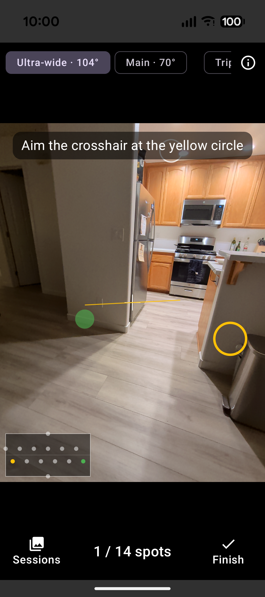
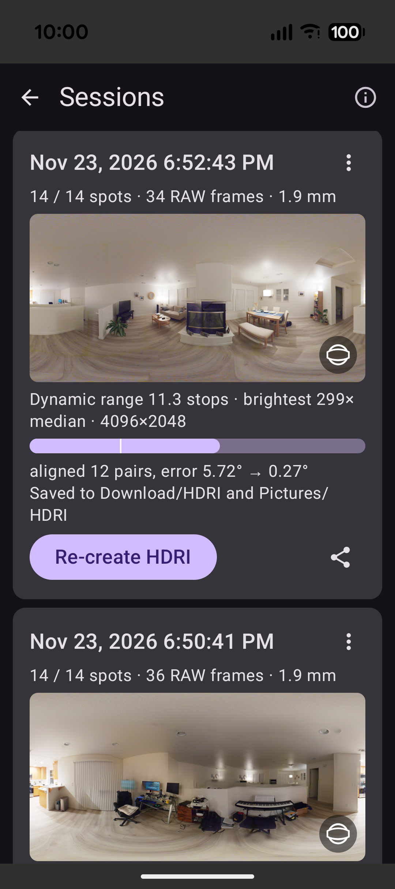
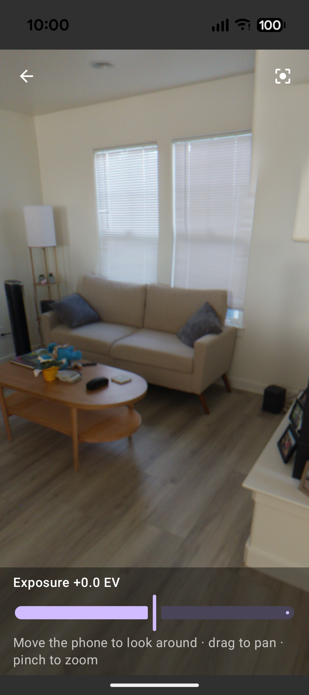

# HDRI Sphere

An open-source Android app that captures **HDR environment maps** (360°×180° equirectangular `.exr` / `.hdr`) with your phone, for lighting and skies in [Godot](https://godotengine.org), [Blender](https://www.blender.org) and other render engines.

<p>



</p>

## How it works

1. The app picks the widest camera that supports RAW + manual exposure (usually the ultra-wide lens). You can also choose a lens yourself.
2. Aim spots covering the whole sphere are drawn over the live camera view. Point the phone at each spot and hold still; the app captures an exposure bracket automatically.
3. Brackets are captured as linear RAW and extended toward shorter exposures until highlights are no longer clipped, so bright skies and lamps keep their real intensity.
4. On the phone, the brackets are merged to radiance, aligned (gyro pose refined with feature matching) and stitched into an equirectangular HDR: `.exr` and `.hdr` at 2K, 4K or 8K, plus a tone-mapped 360° JPEG.
5. A built-in viewer lets you look around the result by moving the phone. You can also export the raw set (DNGs, `session.json` and a Hugin `.pto`) to stitch elsewhere.

Requires a camera with Camera2 RAW and manual-sensor support, Android 10 or newer.

## Repository layout

| Path | Contents |
|---|---|
| `app/` | Android app (Kotlin, Jetpack Compose, Camera2) |
| `core/` | C++17 HDR and stitching core (OpenCV), built with the NDK |
| `fastlane/` | Store listing: descriptions, icon, screenshots |
| `fdroid/` | F-Droid build metadata (submitted to fdroiddata) |

## Building

Requirements: JDK 21, Android SDK with platform 37, NDK 29.0.14206865.

```sh
./gradlew :app:assembleDebug        # debug APK (arm64 + x86_64 for emulators)
./gradlew :app:testDebugUnitTest    # unit tests
./gradlew :app:assembleRelease      # release APK (arm64), unsigned unless signing is configured
```

## Releases

Pushing a tag `vX.Y.Z` that matches `versionName` in `app/build.gradle.kts` runs `.github/workflows/release.yml`. It builds the release APK and attaches it to a GitHub release. To sign it, add these repository secrets:

| Secret | Value |
|---|---|
| `RELEASE_KEYSTORE_BASE64` | `base64 -w0 release.jks` |
| `RELEASE_KEYSTORE_PASSWORD` | keystore password |
| `RELEASE_KEY_ALIAS` | key alias |
| `RELEASE_KEY_PASSWORD` | key password |

Remember to bump `versionCode` and `versionName` and add `fastlane/metadata/android/en-US/changelogs/<versionCode>.txt` for each release.

## License

GPL-3.0-or-later. See [LICENSE](LICENSE).
